# Android UI/UX overhaul — design-v4 report

Lane: Mobile UI/UX overhaul · branch `base/v2` · commits `8c7ad97`, `31dbfdb` and the commit carrying this report.
I verified everything on the iOS Simulator (iPhone 17, native dev build, `EXPO_PUBLIC_API_URL` = prod ELB, GET only, location 28.6139, 77.2090). Screenshots are in `android-overhaul-shots/{before,after}/`, downscaled to 700 px.

## 1. Diagnosis: why it read as "AI-generated"

These are the tells I found in `Mobile/` before this pass, worst first:

1. **Font mixing.** The numbers and eyebrows used IBM Plex Mono, set in lowercase with wide letter-spacing, next to Satoshi body text. Mono for numbers is the most common "AI dashboard" signature (see before `14-map.png`, "your day so far").
2. **Uniform outlined cards.** Every section was the same rounded rectangle with a hairline border and the same padding. The page had no hierarchy, just a stack of boxes.
3. **Icon-in-a-tinted-tile rows.** The sidebar, home doors, search, onboarding and the Delhi Today pollutant tiles each put the glyph in a pastel well (sky/clay/sand/plum). This is the template-catalogue look.
4. **Decorative colour.** The tint wells and chips used several hues that meant nothing. Green was the identity colour everywhere: icons, fills, links and the "good" band. The app read as a green app, and colour stopped carrying information.
5. **Numbers with no meaning.** The big numbers ("798 µg") had no reference next to them. The felt word could contradict the reference ("fine" next to 3.7× the WHO limit).
6. **The hero was a card.** The day's number sat inside a bordered, shadowed `BreathEdge` box like any other widget, instead of being the subject of the page.
7. **Glass and transparent surfaces.** The map pick hint, the search action bar and the drawer shadow used translucent fills with accent outlines.
8. **Mixed scripts in English.** The sidebar language badge read `अA`, and the basemap printed every road and place name twice (Latin + Devanagari) even in the English experience.
9. **Editorial copy.** "smoke", "breath" and "philosophy" lines carried meaning that labels and references should carry.

## 2. References and what I took from them

- **Apple Weather / Health.** The number is the page. One very large, light numeral, a condition word under it, and context lines in secondary grey. Grouped inset lists instead of separate cards.
- **Carrot Weather.** The hero numeral is huge, tight and light, and the canvas tone answers the condition.
- **Gentler Streak.** Warm off-white base, a single brand colour used sparingly, and status colour only on data.
- **Samsung One UI.** Big header area, content pushed into reachable lower space, clear tonal (not outlined) surfaces.
- **CPCB / India AQI scale.** Delhi residents already know the words *good, satisfactory, moderate, poor, very poor, severe*, so the felt words now come from this scale instead of invented ones.

Where I disagreed with an earlier brief: I removed the mono numerals entirely (the brief only said "Satoshi stays") and made clean air **slate blue, not green**. A green good-band plus a forest brand colour made the app read as green, which the owner rejected.

## 3. The system

### Colour logic: colour only ever speaks about the air
| Role | Token | Value | Where it may appear |
|---|---|---|---|
| Base | `bg` / `surface` / `surface2` / `surface3` | `#FAFAF7` / `#FFFFFF` / `#F3F2EC` / `#EBE9E1` | all chrome; warm neutral, never green-tinted |
| Ink | `text`…`text4` | `#16181D` → `#A6ACB8` | copy, neutral icons, large fills (the "Where to?" bar, retry, share-choice) |
| Accent | `accent` / `accentInk` | `#35614B` / `#2A4D3B` | **small only**: the "-108" wordmark, switches that are on, the selected route/mode, the live freshness dot |
| Air bands | `band0`…`band5` | slate `#6E93AE` → wheat `#B9A46C` → amber `#CF8A50` → terracotta `#BE6440` → brick `#974532` → umber `#62392C` | hero numeral + felt word, page mood wash, hour bars, week/day cells, dose dots, budget fill, over-WHO pollutant values |

- Every decorative tint well (`V2Tint.sky/clay/sand/plum`) collapsed to one neutral stone.
- The budget bar takes its colour from the dose tier (`doseDotColor`), not from forest.
- The selected hour in `HourArc` keeps its band colour and is marked by full opacity, never by switching to black.
- Vehicle colour in "how Delhi moves" stays on the exhaust ramp (car = deepest). That colour is about emissions, so it is semantic.

### Type scale (Satoshi only; nothing under 11 pt)
| Step | Size | Use |
|---|---|---|
| Hero numeral | 112 / lh 118, tracking −5, light | the day's dose |
| Display | `V2Type.display` | felt word under the numeral |
| Title | screen titles, section leads |
| Body | rows, list names |
| Secondary | references ("6% of your daily budget", "3.7× the WHO daily limit") |
| Label | units, chips, axis ticks (≥ 11) |

`FMONO` now resolves to Satoshi with tabular figures, so the old mono call sites compile and render in one family.

### Surface hierarchy
1. **Page.** Warm paper, washed by today's band. The hero sits directly on it with no container.
2. **Grouped list.** White, ambient shadow, inset dividers, no border. Used for home doors, settings, the Delhi Today pollutant list and the measured-streets list.
3. **Sheets.** Solid white, no glass.
4. **Floating controls.** Tonal fill plus soft shadow, no outline.

Hairlines remain only as inset list dividers and to mark selection or emptiness.

### Meaning layer (every big number has a unit and one reference)
- **Home.** `12 µg` → `good` → `6% of your daily budget`, plus counted time, the outside reading and its band word. When there are fewer than `THIN_SAMPLE_MIN` (3) samples, the hero shows the ambient reading against the WHO limit instead of a made-up dose.
- **Delhi Today.** Day's dose → CPCB word → `N× the WHO daily limit` · `~56 µg/m³`. Each pollutant shows its measured value and its WHO reference (PM10 45, NO₂ 25, O₃ 100, CO 4000, SO₂ 40). Only values over the reference turn terracotta.
- **Climatology** reads "x% above/below the 10-year average for this hour (med µg/m³)".
- **Range line.** "likely between lo and hi" is hidden when the lower bound rounds to 0, because "between 0 and 2007" is real but tells a stranger nothing.

### Motion grammar
- The band wash eases between bands instead of snapping.
- The hero breathes slowly.
- Pressables use a spring scale on press.
- All of it is gated by Reduce Motion (static wash, no breathing, no spring scale).

### States
- **Sparse.** Ambient reading plus WHO reference, no fabricated dose.
- **Empty.** Trips shows a neutral empty state. Delhi Today streets shows the k≥3 explanation.
- **Loading.** Existing waiting text kept.
- **Error.** Compare-sheet retry is a dark-ink button.

## 4. Changed surfaces
| File | Change |
|---|---|
| `src/theme.ts` | warm neutral tokens, muted forest accent, slate→umber band ramp, neutral `V2Tint`, Satoshi for `FMONO`, `doseDotColor` / `doseTierIdx` |
| `src/screens/HomeScreen.tsx` | page-level hero (112 pt numeral + CPCB word + reference), band-mood canvas, pinned "Where to?", grouped doors, neutral move chips with band dots, tier-coloured budget bar; keeps WeekStrip/HourArc from `0c045de` |
| `src/components/shell/HourArc.tsx` | selected hour keeps its band colour |
| `src/screens/DelhiToday.tsx` | no hero card; pollutant grouped list with WHO references; streets as a grouped list (no icon tiles); uninformative range hidden |
| `src/i18n/strings.ts` | CPCB felt words, reference strings (`refWhoOver/Under`, `refBudget`, `refYesterday*`, `whoRef`, `cityTypical*`), shorter door labels; en+hi parity is enforced by `Record<StringKey,string>` |
| `src/components/shell/CompareSheet.tsx` | neutral mode glyphs, forest only on the selected option, tonal selection (no outline), ink retry |
| `src/ui.tsx` | mode row selection by tone + elevation, no border |
| `src/components/shell/Sidebar.tsx` | no drawer shadow or separators, Satoshi wordmark with forest "-108", neutral glyphs, translate icon instead of `अA`, "add" in neutral ink |
| `src/screens/SearchScreen.tsx` | no glass action bar, no glyph wells |
| `src/screens/SettingsScreen.tsx` | borderless inputs/buttons on stone |
| `src/screens/OnboardingScreen.tsx` | neutral journey rows, ink share-choice |
| `src/screens/LedgerScreen.tsx` | trip mode box and empty glyph neutral (not forest) |
| `src/components/CityMoves.tsx`, `ReceiptSheet.tsx`, `FreshnessChip.tsx` | decorative forest removed from glyphs |
| `App.tsx`, `src/map/style.ts` | solid map pick hint; `latinLabels()` gives the English map Latin-only labels, while Hindi keeps the bilingual basemap |

No features removed. No new network calls (GET-only unchanged). No dependencies added.

## 5. Before / after
| Screen | Before | After |
|---|---|---|
| Home top | 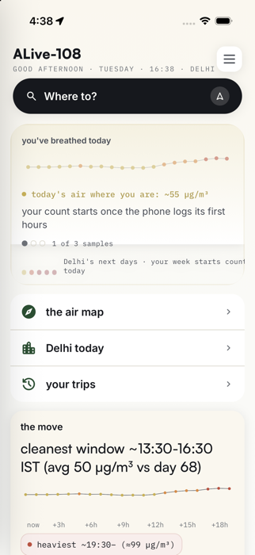 | 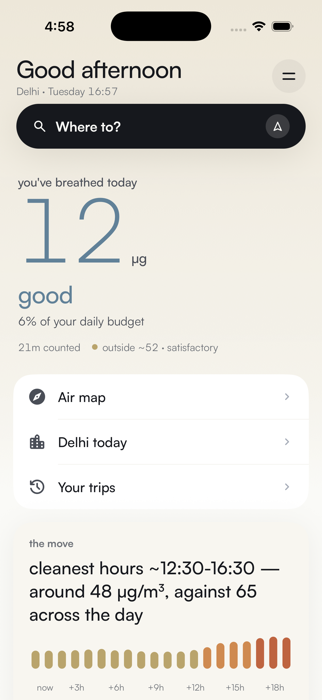 |
| Home scroll | 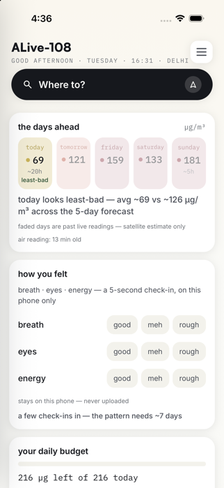 | 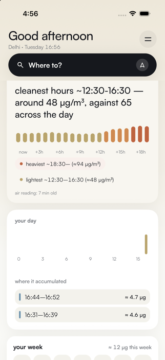 |
| Home lower | 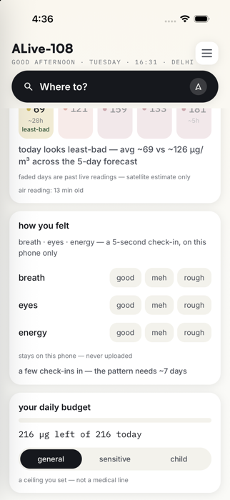 | 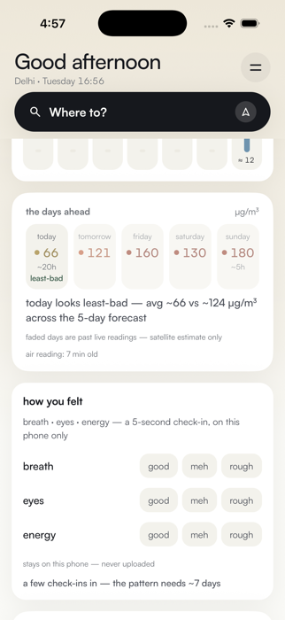 |
| Home bottom |  | 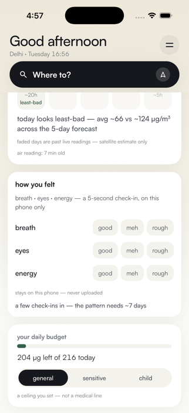 |
| Delhi Today | 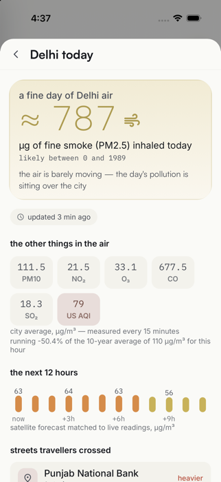 | 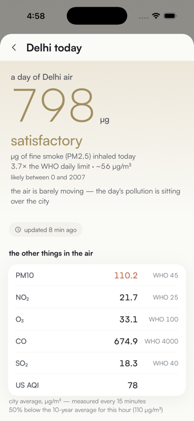 |
| Delhi Today lower | 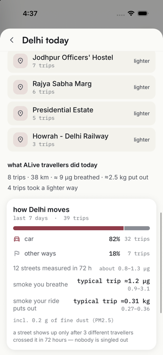 | 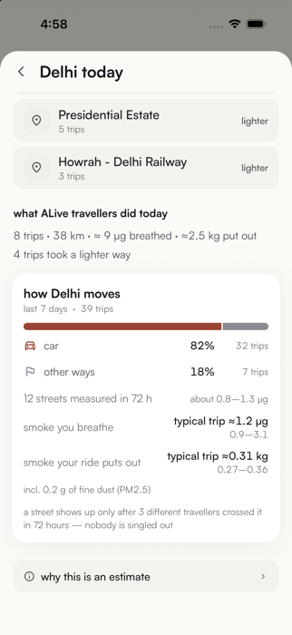 |
| Map | 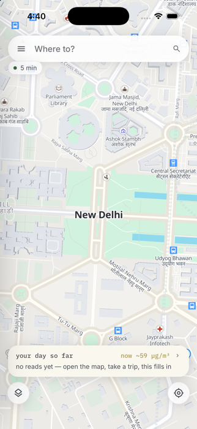 | 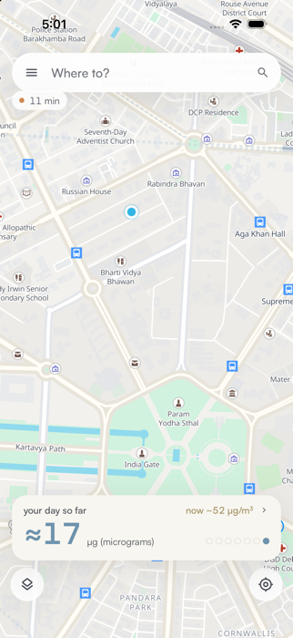 |
| Search | 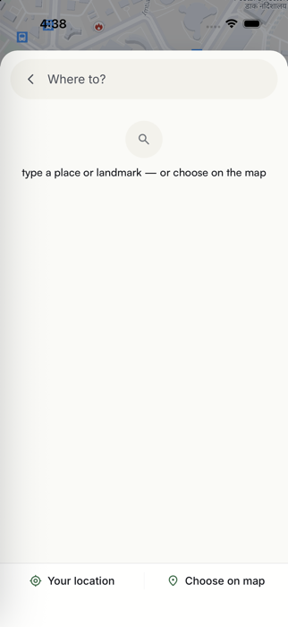 | 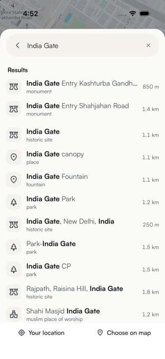 |
| Sidebar | 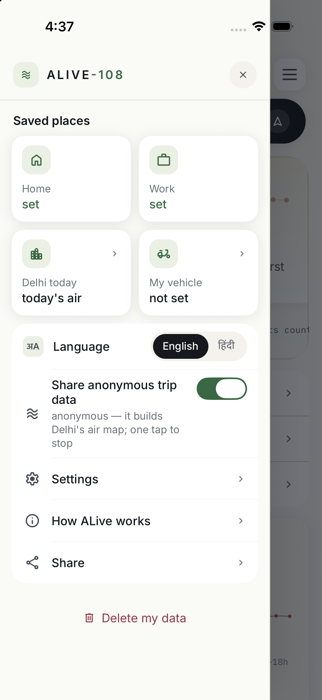 | 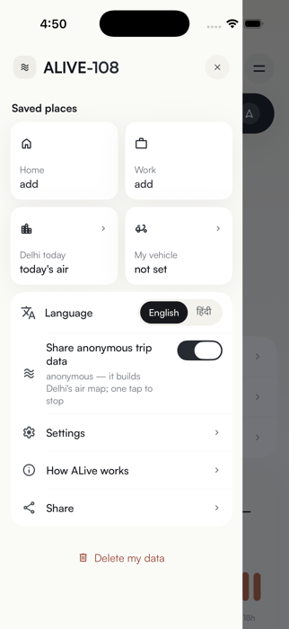 |
| Settings | 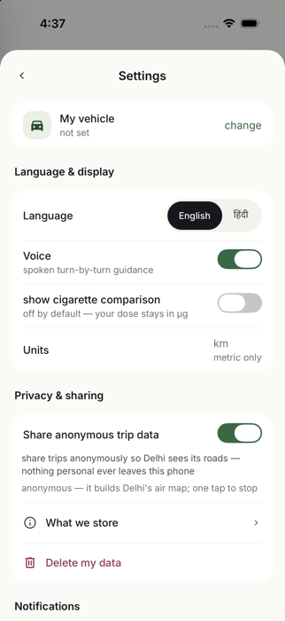 | 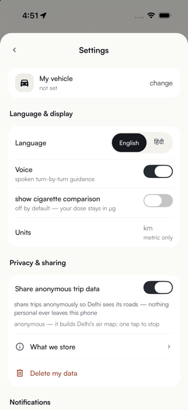 |
| Trips (empty) | 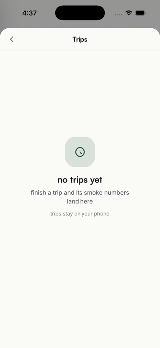 | 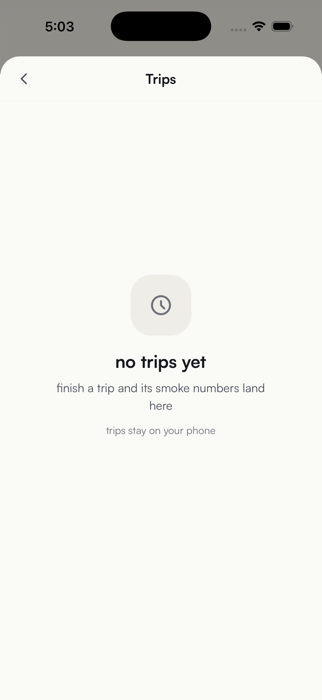 |

After-only: `after/vehicle.png` (vehicle sheet), `after/compare.png` and `after/compare_list.png` (route comparison), `after/layers.png` (layers sheet), `after/search_recent.png`, `after/city_mid.png`, `after/city_scroll1.png`, `after/city_scroll3.png`.
Before-only: `before/00-launch.png`, `before/01-onboard-2.png`, `before/02-onboard-3.png`, `before/12-settings-2.png`.

## 6. Gates
```
cd Mobile && npx tsc --noEmit   → 0 errors
cd Mobile && npx expo lint      → 0 errors, 0 warnings
```
I also checked the English dictionary: it contains no Devanagari outside code comments.

## 7. Limitations and untested flows
- **Not re-shot after the redesign:** welcome film, onboarding 1–3, receipt sheet, check-in sheet, report sheet. Showing them needs a reset install or a finished trip. Their code changes are colour/border only and type-checked, but not visually confirmed.
- **Language switch not tested on device.** The map label language changes `mapStyle`, which reloads the style once when the language is switched.
- **Android not run.** Verification was on the iOS Simulator only. The styles are cross-platform RN, but Android elevation renders shadows differently from iOS.
- **Layers sheet z-order.** The layers sheet can stay above the sidebar if the sidebar is opened while it is up. I saw this during capture and did not change it (out of scope, not caused by this pass).
- **Remaining tile layout.** The sidebar still uses a 2×2 saved-places tile grid. The Delhi Today sentence "the air is barely moving…" comes from the server's `why` line and was left as is.
