# vibe-polish — report (base/v2)

Surface-craft pass on `Mobile/` against `docs/plan/design-refs.md` (Oura /
WHOOP / CRED / Uber / Apple Health). Structure untouched: same cards, same
journey, same copy — all deltas are tonal, type, and edge discipline.
Before/after pairs below are device captures (iPhone 17 sim, live API,
`before` left / `after` right).

## The audit — what actually read "odd"

Four systemic defects, all surface-level:

1. **Content-bearing panes were translucent.** Delhi today, Trips, Settings,
   Search, the vehicle wizard, the drawer, and the receipt all rendered on
   `glass`/`glassDeep` (91–95% white). A populated home + live map sat behind
   them, so "HOW YOU FELT", eyebrows, map labels, and the MapLibre attribution
   ghosted through as faint phantom text — the #1 "looks like a bug, not a
   vibe" defect. Translucent panes are only correct where the *map* should
   stay legible (search bar, chips, DayPeek, compare sheet, HUD tiles).

2. **Numerals didn't own their cells.** DAYS AHEAD cells carried the dose at
   13px in band-ink (85% band colour) — washed into the tinted fill, the
   opposite of a WHOOP/Oura numeral. Ledger's breathed-µg total sat at the
   same 22px as trip-count and kg — the app's number had no hierarchy.

3. **Compare option labels truncated mid-word.** Wire suffixes
   (`· your usual`, `· least-smoke alt N`) were concatenated into a
   single-line `flexShrink` label competing with chips — producing
   "Bike / scooter · y…" and "Cab · l…". Meaningless fragments.

4. **Receipt's dose scale + stats were under-weight.** A 5px `line`-grey
   track ghosting over the map, stat values at 15px.

## The deltas

**Sheet-surface rule** (now codified in `register-card.md`): panes covering
*content* are solid `V2T.bg` + `hairline` edge; scrim carries the dim.
Translucency stays only where the map shows through on purpose.
→ `DelhiToday`, `LedgerScreen`, `SettingsScreen`, `SearchScreen`,
`VehicleSheet`, `Sidebar` panes `glassDeep → bg`; `ReceiptSheet`
`glass → bg` (+ `glassEdge → hairline`).

**Type hierarchy**: days-ahead cell numeral 13px band-ink → 15px full ink
(band still reads via the deep wash, dot, and band-inked day label);
ledger breathed-µg → `display` 30px serif with a demoted `µg` unit run —
the dose owns the summary card.

**Compare labels**: suffix split into a nested dim qualifier (`optQual`,
label-size, text3) inside a 2-line label — full qualifier always, never a
mid-word ellipsis.

**Receipt**: dose-scale track 5→6px on `hairline` (reads on paper),
stat values 15→17px (`body`).

No new fonts, no new tokens consumed by name, no copy rewrites beyond the
truncation defect, no layout changes.

## Before / after

Home (days-ahead numerals):

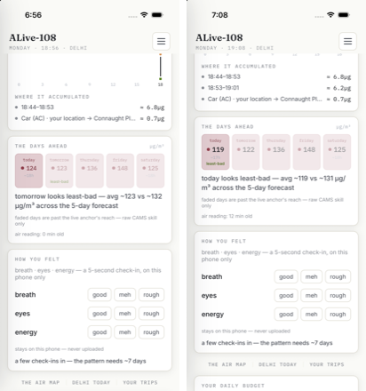

Sheets (ghosting → opaque):

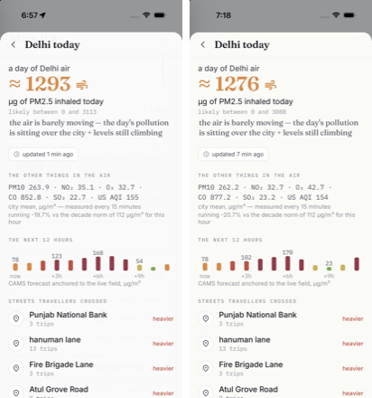
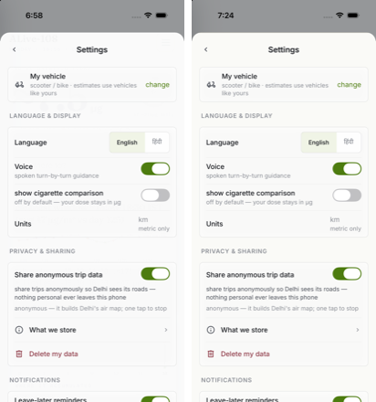
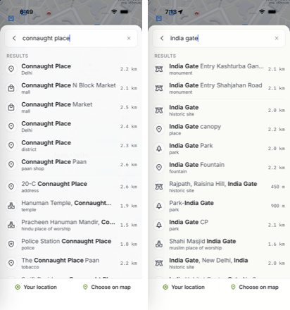
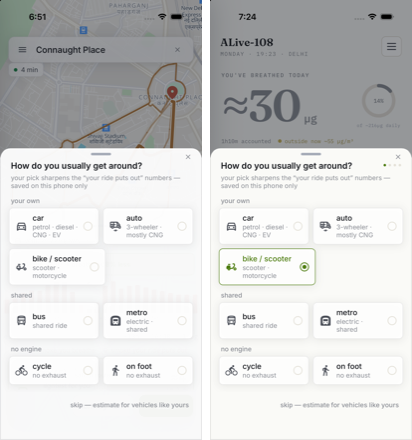
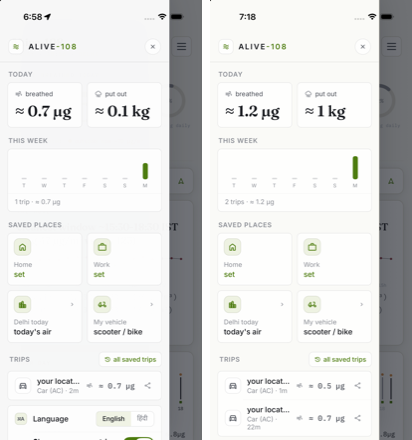
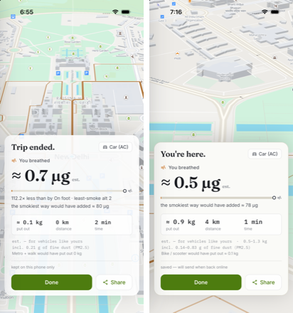

Compare (label qualifier):

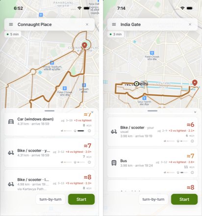
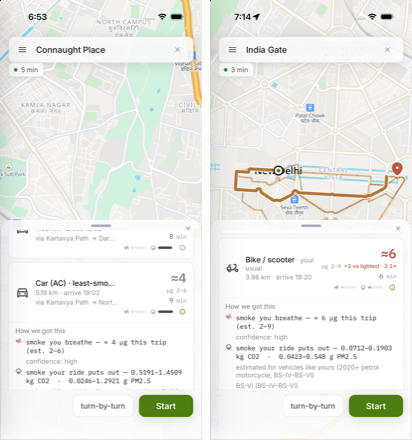

Reference frames (unchanged surfaces, sanity):

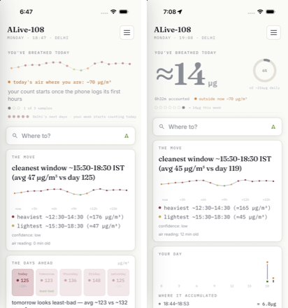
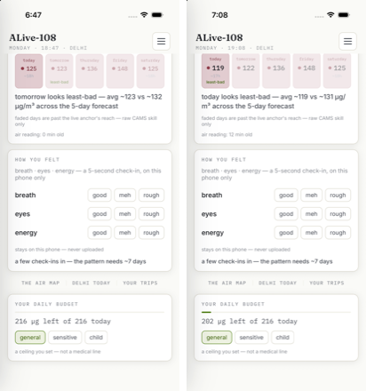
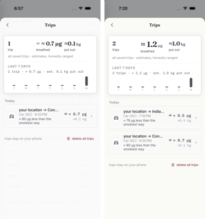

Ledger pair shows the breathed-µg hero at `display` vs siblings at `title`.

## Verification

- `npx tsc --noEmit` clean · `npx expo lint` clean · store runner 18/0 fail · nav runner 68/0 fail.
- Journey driven end-to-end on the sim after the pass: search ("india gate") → vehicle preset → compare (cards + detail expander) → nav (banner + live counters) → GPS arrival → receipt → back to compare/home. All green.
- System-font audit (style-aware, every `Text`/`TextInput` vs its effective family): **zero fallbacks** — every label ships `fam*`/`famSerif`/`famMono*`.
- Register card: `docs/lanes/register-card.md`.

## Known flake (pre-existing, not this pass)

`com.anonymous.app` SIGSEGV'd twice on the sim during sheet opens
(`domain:signal code:SIGSEGV(11)` in SpringBoard's log) — the MapLibre /
virtualized-GPU crash class already documented in `App.tsx`
("upstream sim SIGSEGV", "residual-SIGSEGV … ci15", the `camDur` guard).
Intermittent; the same open path succeeded on retries and the full journey
ran clean. Nothing in this pass touches map lifecycle or mount choreography.
Worth its own lane if it ever reproduces off-sim.
